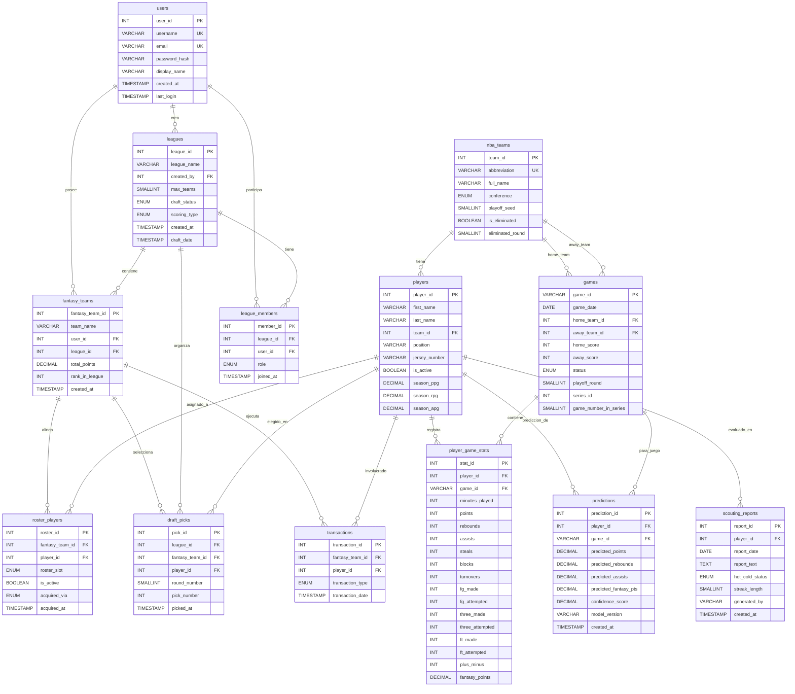

# Playoff Hoops - Diagrama Entidad-Relacion

## DER (Mermaid)

Pegar en https://mermaid.live para visualizar.

## Relaciones M:M con atributos (NO diccionarios)

| Junction | Entidad A | Entidad B | Atributos propios |
|----------|-----------|-----------|-------------------|
| player_game_stats | players | games | 15 attrs: minutes, pts, reb, ast, stl, blk, tov, fg_m/a, 3p_m/a, ft_m/a, +/-, fantasy_pts |
| league_members | users | leagues | role (commissioner/member), joined_at |
| roster_players | fantasy_teams | players | roster_slot (G1/G2/F1/F2/C/UTIL/BN1/BN2), is_active, acquired_via (draft/FA/trade), acquired_at |

## Cardinalidades

| Relacion | Cardinalidad | Descripcion |
|----------|-------------|-------------|
| nba_teams → players | 1:N | Un equipo tiene muchos jugadores |
| nba_teams → games (home) | 1:N | Un equipo juega muchos partidos como local |
| nba_teams → games (away) | 1:N | Un equipo juega muchos partidos como visitante |
| players ↔ games | M:N | Via player_game_stats (15 attrs) |
| users → leagues | 1:N | Un usuario crea muchas ligas |
| users ↔ leagues | M:N | Via league_members (role, joined_at) |
| users → fantasy_teams | 1:N | Un usuario tiene equipos fantasy |
| leagues → fantasy_teams | 1:N | Una liga contiene equipos |
| fantasy_teams ↔ players | M:N | Via roster_players (slot, via, active) |
| leagues → draft_picks | 1:N | Una liga tiene picks de draft |
| fantasy_teams → draft_picks | 1:N | Un equipo hace picks |
| fantasy_teams → transactions | 1:N | Un equipo ejecuta transacciones |
| players → predictions | 1:N | Un jugador tiene predicciones |
| games → predictions | 1:N | Un juego tiene predicciones |
| players → scouting_reports | 1:N | Un jugador tiene reportes |
